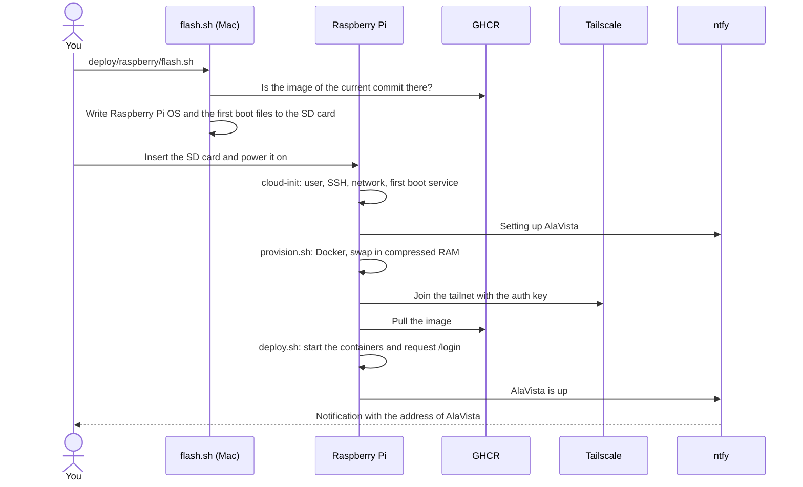

# Start-up of the Raspberry Pi

This page explains what happens from a blank SD card to AlaVista running on the Pi, and how to follow it. The steps to run, and the one-time setup of Tailscale and GitHub, are in the [deployment guide](README.md).

## Overview

The whole process takes about half an hour, most of it on the Pi. The times below are rough estimates for a Pi 3 Model B.

## 1. On your Mac: `flash.sh`

[`flash.sh`](flash.sh) prepares the SD card in a few minutes, plus the download of Raspberry Pi OS the first time:

1. It checks that GHCR has the image of the commit you run it from, `sha-<commit>`, because that is the image the Pi deploys.
2. It reads `flash.env.local` and asks for the missing settings: the Wi-Fi network and the Tailscale auth key. The first time, it generates the ntfy topic and saves it to that file.
3. It downloads the latest Raspberry Pi OS Lite (64-bit) to `~/Library/Caches/alavista`, only when there is a new release, and verifies its SHA-256 checksum.
4. It lists the external and removable disks, and writes the image to the one you type.
5. It writes these files to the boot partition, which the Mac can read and write:

   | File                                  | Purpose                                                                                           |
   | ------------------------------------- | ------------------------------------------------------------------------------------------------- |
   | `user-data`                           | cloud-init settings: hostname, time zone, your user with your SSH key, and the first boot service |
   | `network-config`                      | Ethernet, and the Wi-Fi network if you gave one                                                   |
   | `alavista/config.env`                 | The image tag, the ntfy topic and the secrets: auth key, Google client and Beszel key             |
   | `alavista/alavista-firstboot.service` | The systemd service that runs `firstboot.sh`                                                      |
   | `alavista/*.sh`, `alavista/*.yaml`    | `firstboot.sh`, `provision.sh`, `deploy.sh` and the Compose files                                 |

6. It ejects the SD card.

## 2. First boot: cloud-init

Raspberry Pi OS runs [cloud-init](https://docs.cloud-init.io/) on the first boot. In a couple of minutes, it reads `user-data` and `network-config` and:

- Sets the hostname to `alavista` and the time zone of your Mac.
- Creates your user, without a password, so that you can only sign in with your SSH key, and enables SSH.
- Connects to the network with NetworkManager.
- Installs and starts the `alavista-firstboot` service.

From then on, you can sign in with `ssh <your user>@alavista.local` from your local network.

## 3. The `alavista-firstboot` service

The service runs [`firstboot.sh`](firstboot.sh), which takes most of the time:

1. **Network:** it waits until the Pi reaches the internet, up to ten minutes. Then it sends the _Setting up AlaVista_ notification.
2. **Provisioning:** [`provision.sh`](provision.sh) upgrades the system and installs Docker, swap in compressed RAM (zram) and Tailscale. The Pi joins the tailnet with the auth key, as `tag:alavista` and with Tailscale SSH enabled. Then the script creates the `deploy` user and `/opt/alavista/.env`, with generated secrets and the Google client, and installs the Beszel agent if you gave its key.
3. **Deployment:** it copies the Compose files and [`deploy.sh`](deploy.sh) to `/opt/alavista`, and runs `deploy.sh` as the `deploy` user. It pulls the image, starts the containers, which run the migrations, and requests `/login` over HTTPS. That first request makes Caddy get the certificate of the `*.ts.net` name from Tailscale.
4. **Clean-up:** it removes `/boot/firmware/alavista`, with the auth key and the Google secret, and disables the service.
5. **Notification:** it sends _AlaVista is up_, with the address of AlaVista. Tapping the notification opens it.

If a step fails, the script sends _AlaVista setup failed_ with the last lines of its log, and keeps the files. The service runs again on the next boot, and the provisioning skips what is already done.

## 4. After the start-up

Set the `PI_HOST` secret in GitHub to the `*.ts.net` name sent in the notification, and add the redirect URI to the Google OAuth client, as the [deployment guide](README.md#2-raspberry-pi) explains. From then on, the CI deploys every push to `main`, and the Pi is not set up again until you write a new SD card.

## Notifications

| Notification            | Meaning                                    | What to do                                                                                                   |
| ----------------------- | ------------------------------------------ | ------------------------------------------------------------------------------------------------------------ |
| _Setting up AlaVista_   | The Pi booted and reached the internet     | Wait for the next one                                                                                        |
| _AlaVista is up_        | AlaVista runs and answers over HTTPS       | Set `PI_HOST` in GitHub and the Google redirect URI                                                          |
| _AlaVista setup failed_ | A step failed, the log lines say which one | Fix the cause, then reboot the Pi to try again                                                               |
| None after 15 minutes   | The Pi has no internet access              | Connect it to the router with a cable and reboot it, or check the Wi-Fi settings and write the SD card again |

The Pi 3 only connects to 2.4 GHz Wi-Fi networks. An Ethernet connection always works, because `network-config` includes it.

## Following it on the Pi

Once cloud-init has created your user, sign in with `ssh <your user>@alavista.local` and use:

- `journalctl -u alavista-firstboot -f` to follow the setup.
- `systemctl status alavista-firstboot` to see whether the service is running, has failed or is done.
- `sudo cat /var/log/cloud-init-output.log` if the service never started, for example because cloud-init failed.

## Secrets on the SD card

The boot partition is not encrypted, so anyone with the SD card can read it until the first boot finishes:

| Secret               | Stored in             | Removed                                                                               |
| -------------------- | --------------------- | ------------------------------------------------------------------------------------- |
| Tailscale auth key   | `alavista/config.env` | When the setup succeeds. Use a one-off key that expires in a day.                     |
| Google client secret | `alavista/config.env` | When the setup succeeds. It stays in `/opt/alavista/.env`, readable only by `deploy`. |
| Wi-Fi password       | `network-config`      | Never. NetworkManager also keeps a copy, readable only by root.                       |
| Beszel key, SSH key  | Several files         | They are public keys, not secrets.                                                    |
